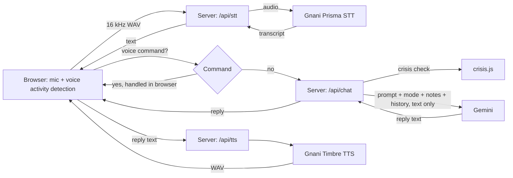

# Anchor: a hands-free voice companion

Anchor is a voice-first friend you can talk to in English, Hindi or Hinglish. It listens, replies in your language and style, remembers what matters to you, and can be controlled entirely by voice, including privacy settings. It is built for people who want someone to talk to, with dedicated modes for blind and low-vision users and for autistic users.

> **Anchor is a companion, not a therapist.** It is not a replacement for professional mental health care. If you are in danger, contact your local emergency number or a helpline.

Built for the **Great Indian AI Internship Challenge 2026** by Gnani.ai.

**Demo video:** `https://drive.google.com/file/d/1xAOPpgmSex1OsaPGLHH1AzwtjJs9pFab/view?usp=drivesdk` 
**LinkedIn post:** `<add link>`  
**Author:** `KHUSHI GUPTA`

---

## Why Anchor

Plenty of assistants can chat. Anchor is designed around a different set of problems:

- **Hands-free by design.** After pressing one button, everything works by voice: switching modes, turning incognito on or off, erasing memories (with spoken confirmation), and ending the session. This helps people who cannot easily use a screen.
- **Indian-language focus.** Speech recognition and synthesis run on Gnani's models, and Anchor replies in the language and style the user speaks, including Hinglish.
- **Privacy controls inside the conversation.** Incognito mode stops memory from being used or saved. "Delete my memories" wipes saved notes after a spoken yes.
- **A safety layer that does not depend on the AI alone.** See [Safety](#safety).

## Features

- Voice conversation with voice activity detection (no push-to-talk)
- Modes: Friend, Calm, Support, Blind / low vision, Autism-friendly (each changes tone, pacing and speech speed)
- Replies in the user's language style, including Hinglish
- Long-term memory as short notes about the person, with spoken delete
- Incognito mode (nothing saved, no memory used)
- Email and password accounts (bcrypt-hashed passwords, JWT cookie sessions)
- Rate limiting on the API, signup and login
- Two-tier crisis detection with a fixed fallback message that works even if the AI is down

## Gnani models and APIs used

| Purpose | Gnani model / API | Where |
|---|---|---|
| Speech to text | **Prisma** (`gnani-prisma-v2.5`) | `POST /api/stt` in `server.js` |
| Text to speech | **Timbre** (`timbre-v2.5`, voice `Nalini`) | `POST /api/tts` in `server.js` |

The conversation itself is generated by Google Gemini (`gemini-3.5-flash-lite`, with `gemini-3.6-flash` as fallback).

## How it works



1. The browser listens continuously and detects when you stop speaking by measuring loudness. A short pre-roll keeps the first word from being cut off.
2. Audio is converted to 16 kHz, 16-bit mono WAV in the browser (the format Gnani expects) and sent to the server.
3. The server forwards it to Gnani Prisma and returns the transcript.
4. Short phrases such as "incognito on" or "switch to calm mode" are handled as voice commands in the browser.
5. Everything else goes to `/api/chat`. The server runs the crisis check, builds the prompt (personality, mode, name, saved notes) and sends **text only** to Gemini.
6. The reply is split into sentences and sent to Gnani Timbre, with the next sentence prefetched while the current one plays.
7. In the background, and only when incognito is off, short notes about the user are updated.

## Safety

Anchor is built for emotionally sensitive conversations, so it does not rely only on a prompt:

1. **Prompt layer.** The AI is instructed to be human and warm, to avoid scripted therapy language, and to respond carefully to distress.
2. **Keyword layer (`crisis.js`).**
   - *Strong* matches (clear statements, English and Hinglish): the AI is given a crisis hint, and a helpline is always appended to the reply.
   - *Soft* matches (ambiguous distress): the AI is told to respond carefully, with no forced helpline.
3. **Fallback.** If the AI service fails during a strong match, a fixed, warm message with the helpline is returned instead of a generic error.
4. **Privacy.** Strong-match conversations are not saved to memory.

### Testing

`node test-crisis.js` runs the keyword layer against a set of phrases (direct, indirect, Hinglish and harmless look-alikes such as "this homework is killing me").

- Results on my own phrase set: `18/18` (note that I tuned the patterns on this set).
- Results on phrases written by other people that I had not seen: `17/17`

**Known limits:** keyword matching cannot catch every indirect or poetic expression of distress, speech recognition can mishear (especially mixed-language speech), and Gemini's response is not guaranteed. This is a safety net, not a guarantee.

## Performance

Tested on Airtel mobile data (4G/5G), not a fixed broadband line, to reflect real-world conditions.

| Step | Result |
|---|---|
| Speech to text (Gnani Prisma) | about 0.15 s (as reported by the Gnani API) |
| Reply generation (Gemini) | being optimised |
| Text to speech (Gnani Timbre) | to be measured |
| Wait after you stop speaking | 800 ms (configurable) |

Full measurements over 20 turns will be added.

## Run it locally

Requirements: Node.js 18 or newer, a Gnani API key, a Google Gemini API key.

```bash
git clone https://github.com/khushidgupta28/Anchor--Your-Friendly-Companion
npm install
cp .env.example .env      # on Windows: copy .env.example .env
# edit .env and fill in your keys
node server.js
```

Open `http://localhost:3000`, create an account, press the big button, and allow microphone access.

### Environment variables

See [`.env.example`](.env.example). `JWT_SECRET` is required: the server refuses to start without it. Generate one with:

```bash
node -e "console.log(require('crypto').randomBytes(32).toString('hex'))"
```

## Project structure

```
server.js          Express server: auth, chat, speech-to-text and text-to-speech routes
crisis.js          Crisis keyword patterns (strong and soft tiers)
test-crisis.js     Test runner for the crisis patterns
public/
  index.html       Interface
  app.js           Voice activity detection, WAV encoding, voice commands, conversation loop
.env.example       Template for environment variables
```

## Decisions and trade-offs

- **Voice commands are handled in the browser.** Short phrases are matched locally so they respond instantly and never reach the AI. Only short utterances count as commands, so a long sentence is never mistaken for one.
- **Sentence-level speech.** Splitting replies into sentences and prefetching one ahead lets audio start sooner without flooding the speech API.
- **JSON file as database.** It keeps setup to zero for a challenge prototype. It is not suitable for many users (see below).
- **Memory as short notes, updated every third message.** This keeps costs and latency down.

## Limitations and next steps

- Data is stored in a local `db.json` file with notes in plain text. Next: a real database, encryption at rest, HTTPS and secure cookies in production.
- Audio is processed in full after the user stops talking. Next: streaming speech recognition for lower latency.
- `ScriptProcessorNode` is deprecated. Next: migrate to `AudioWorklet`.
- Conversation text and saved notes are sent to Google Gemini, and audio to Gnani, to produce replies. A production version needs a clear privacy notice, consent flow and review of both providers' data terms.
- The keyword layer needs more phrases, reviewed by native Hindi speakers and other regional-language speakers, and testing with real users.
- Google or Microsoft sign-in.

## How this was built

I designed the product and its safety behavior, wired the Gnani and Gemini services together, and tested and debugged the system end to end. I used an AI assistant (Claude) for code drafting and debugging help, and verified behavior by running and testing it myself.

## Disclaimer

Anchor is an experimental project. It is not a medical device and not a substitute for professional care.
